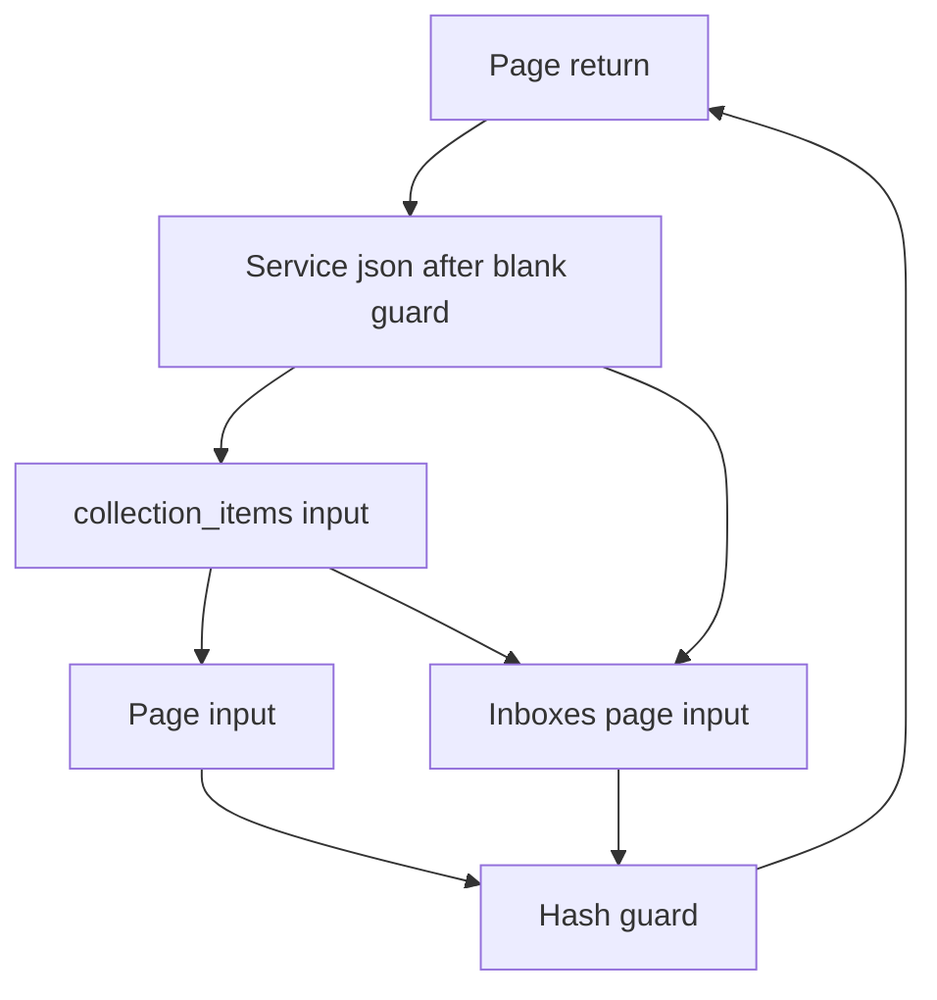

# Strict pending guard

Unscored research reference. An independent rerun upholds the research-base result, with corrections listed below.
The result on upstream main has no independent check.

## Fact F74

On `strict-pending-guard-20261021-four-apps-v0a0`, a six-line change makes positive class guards strict: a Pending (not yet computed) input stays Pending. It removes a reader of absence inside a cycle. Without it, on F73's candidate, Mastodon's `is_a?(Hash)` guard in `fetch_collection_page` turns a Pending argument into `Hash[Unresolved, Unresolved]`; a six-slot cyclic component (the page return, three inputs and two guards) carries that value with no outside support, keeping it at unset/1/repeat and dropping it at schedule 2. With the guard, Mastodon goes from 5/10 to 10/10 schedule-equal tables and from 138 varying rows to 0 at V0A0. On a port of the same flags to upstream main `1c84d346`, it goes from 5/10 to 10/10 and from 147 to 0 across twelve schedules (unset, 1, 2, repeat and seeds 3–10). Without the guard, main's four standard schedules were equal only because each kept the same premature Hash; seeds 4–8 and 10 drop it. Campfire stays 10/10; Forem and Chatwoot stay 9/10. No value set narrows; the same 24 Mastodon rows widen in both conditions, a precision cost. The guard adds no witnessed loss, but F73's losses remain: this is an order-independence result, not a soundness certificate. Twelve structural identities on main remain unclassified. An independent rerun upholds the research-base result with corrections; the main-port result has no independent check.

## The mechanism: a reader of absence inside a cycle

`JsonLdHelper#fetch_collection_page` returns its argument when `collection_or_uri.is_a?(Hash)`
(`app/helpers/json_ld_helper.rb:321` in the pinned Mastodon). Early in the main phase that argument is still
Pending: no caller's value has arrived yet. The old guard intersected Pending with Hash and produced
`Hash[Unresolved, Unresolved]`, a value no caller supplied. That value then feeds back through six slots that
form one strongly connected component in both traced schedules:

- the page return, `JsonLdHelper#fetch_collection_page`;
- its first parameter, and the first parameter of `ActivityPub::InboxesController#fetch_collection_page`;
- the first parameter of `JsonLdHelper#collection_items`;
- the `is_a?(Hash)` guard slot;
- the `return if @json.blank?` guard slot in `ActivityPub::FetchFeaturedCollectionService#call`.



The traced reads from outside the component (48 changed input states at unset, 67 at schedule 2) carry no Hash
variant. The cycle keeps its own premature value, and whether it survives depends on the schedule: on F73's
candidate the page return keeps the Hash variant at unset, 1 and repeat and loses it at schedule 2. Only six of
Mastodon's 138 varying rows are slots of the cycle; the other 132 lie outside it. With the seed removed, all 138
become equal.

The change ([research-base.patch](research-base.patch), [main-port.patch](main-port.patch)) adds the same six lines
on both bases. With `RH_STRICT_GUARD=1` (off by default), `intersect_variant` returns a Pending input unchanged.
This covers the positive side of `is_a?`, `kind_of?` and `instance_of?` guards, including inside compound
conditions, not only this Hash test. The reference path already kept unknown variants and is unchanged. With the
guard, both full traces contain no write of the Hash variant into the component, in the main phase or any
completion pass. The six-slot cycle is still there; it now carries `Unresolved | nil`.

## Research base: F73's candidate, four schedules

Condition: `strict-pending-guard-20261021-four-apps-v0a0`, the candidate `mutation-writers-66c06f52` plus the
guard, label `strict-pending-guard-48155b34`. Checker `quick-test-v1 / cached-observers-20261015-source-rebuild / F61`,
V0A0, schedules unset, 1, 2 and an independent unset repeat. All 16 guard cells are valid native runs.
Source: [research/strict-pending-guard-48155b34](https://github.com/bunnykong/roundhouse/tree/fcbd4a77a1d03c4a5e9be78e8fd86dbff810b5fb). The branch holds a build-identical snapshot of measured commit `48155b34` with the
`research/` harness files removed, so its hash differs.

| App | Equal tables without the guard | Equal tables with the guard |
| --- | ---: | ---: |
| Campfire | 10 | 10 |
| Forem | 9 | 9 |
| Chatwoot | 9 | 9 |
| Mastodon | 5 | 10 |

| Mastodon table | Varying rows without | Varying rows with |
| --- | ---: | ---: |
| returns | 47 | 0 |
| params | 7 | 0 |
| ir | 67 | 0 |
| side_table | 10 | 0 |
| controller_cache | 7 | 0 |
| other five tables | 0 | 0 |

Forem's 4 and Chatwoot's 2 varying controller-binding rows are the same with and without the guard. Against the
candidate without the guard, no row narrows in any app or schedule; the 24 Mastodon widenings below appear in every
schedule; Campfire, Forem and Chatwoot values are unchanged. Error diagnostics are unchanged. Mastodon's
gradual-untyped warnings rise by 11 at unset, 1 and repeat (total 7,183 to 7,194); schedule 2 already had 7,194.
With the flag unset, Campfire unset reproduces all ten table digests of the candidate.

## Independent rerun of the research base

Fresh native runs of the same binary (24 guard cells and 7 controls, no cache hits) reproduce every V0A0 table
above, the 24 widenings and the added and removed identities. The rerun adds these corrections and limits:

1. The change is broader than the Hash test: it applies to every positive class guard (see above).
2. Runtime admission: 832 expression checks and 12 Hash-return checks pass across the four schedules. Two option
   aliases added with the guard, `ResolveAccountService#call[1]` and `#process_options![1]`, are typed
   `Hash[Symbol, Boolean]`. They pass all 56 checks for the Boolean options that pinned callers pass. A public
   caller passing a Hash with String values fails 8 checks (two aliases, four schedules). The old parameter rows
   reject the same Hash, so this is an inherited restriction, not a new loss. It still rules out claiming that
   every changed row admits every public-call value.
3. V1A1 (verification and audit on): Campfire and Mastodon keep 10/10 equal final tables, with zero Pending at
   settlement. Mastodon's earlier verification passes still move rows in every schedule:

   | Schedule | Production verification: returns / params / IR | Absorb verification: returns / params / IR |
   | --- | ---: | ---: |
   | unset | 9 / 19 / 113 | 3 / 1 / 17 |
   | 1 | 9 / 13 / 84 | 1 / 1 / 2 |
   | 2 | 13 / 16 / 122 | 3 / 0 / 17 |
   | repeat | 9 / 19 / 113 | 3 / 1 / 17 |

   Flags-off controls at unset and 1 fail the same checks, so this failure predates the guard.
4. The standard report exits incomplete because Mastodon has added and removed row identities, not because
   cells are missing.

## A port to upstream main, twelve schedules

Condition: `strict-pending-guard-main-port-20261021-v0a0`. The base is upstream main `1c84d346` (October 21) with
the candidate's flags ported as opt-in commits, together with the observer and scheduler ports (`93cc8346`,
[research/main-port-mutation-writers-93cc8346](https://github.com/bunnykong/roundhouse/tree/93cc83466ad674b8dbe9070a2ce00784870a11a6)). The guard commit is `7bd46672` ([research/main-port-strict-pending-guard-7bd46672](https://github.com/bunnykong/roundhouse/tree/7bd46672796c5fa2cd1de6759f3c3a5483efc7f7)); both
branches hold the measured commits. Both Mastodon runs use one binary built with the guard, under the
same flag profile and `RH_SCHED=sccq`; only `RH_STRICT_GUARD=1` differs. Mastodon ran twelve schedules: unset, 1,
2, repeat and `RH_SHUFFLE` seeds 3 to 10. For the other apps, the runs without the guard reuse the port's earlier
cells.

| Mastodon table | Varying rows without | Varying rows with |
| --- | ---: | ---: |
| returns | 47 | 0 |
| params | 7 | 0 |
| ir | 67 | 0 |
| side_table | 10 | 0 |
| controller_cache | 16 | 0 |
| other five tables | 0 | 0 |

Without the guard, the page return keeps the Hash variant at unset, 1, 2, repeat, 3 and 9, and loses it at 4, 5,
6, 7, 8 and 10. On the four standard schedules every run kept it, so all ten tables were equal there; seeds 4–8 and 10
each make five tables vary. With the guard, no schedule has the Hash variant and all ten tables are equal.

Campfire, Forem and Chatwoot (four standard schedules) keep 10/10, 9/10 and 9/10 equal tables with and without the
guard, with no value changes. Forem's 5 and Chatwoot's 2 controller-binding rows vary with and without the guard.
Mastodon's 24 widened rows are wider in all twelve schedules (288 row-schedule widenings), with no narrowed or
incomparable row. They are the same rows, with the same before and after types, as on the research base.
Twelve side-table identities exist on one side only: nine are added in every schedule, and three are removed in
the six schedules that keep the Hash variant. A missing row has no value set to compare, so they stay unclassified.
Mastodon has 635 errors in every cell; totals are 7,672 where the Hash variant is kept and 7,679 elsewhere.

With the flags off and the guard off, Campfire unset reproduces all ten digests of the port without the guard.
With the guard commit, the port's default Rust suite passes 6,858 tests, with 466 ignored; nine cases first failed
on missing test prerequisites and passed when rerun with them.

## The 24 widenings

All are IR rows in `app/services/resolve_account_service.rb` ([widenings.tsv](widenings.tsv)). The pinned callers
pass Boolean options or an empty Hash, so for that caller domain all 24 are a precision cost. Nine lie in the
Account branch of `process_options!`, where for example `Account` becomes `Account | Unresolved` and the String
username becomes Unresolved. Column `unrestricted_public_hash` marks 14 rows `L`: if a public caller passes a Hash
with String option values, these now admit values the old types rejected. The other 10 rows (`I`) are pure
imprecision under that input too.

## Runtime witness

[page_hash_witness.rb](page_hash_witness.rb) loads the unchanged `fetch_collection_page` from the pinned Mastodon
source and passes three nonempty Hashes. CRuby 4.0.7 returns each one unchanged. With the guard the inferred page
return is `Unresolved | nil`, and Unresolved admits every value. The explicit Hash variant was redundant beside it,
so removing it excludes no Hash.

## Limits

- This is an order-independence result, not a soundness certificate. The base candidate keeps F73's witnessed losses.
- Forem and Chatwoot still vary in controller bindings.
- The structural identities stay unclassified: 13 on the research base and 12 on main
  ([structural-identities.tsv](structural-identities.tsv)).
- The patches apply to the candidate and port branches above, not to upstream main alone:
  `strict_producers::is_p` comes from the ported flags.

## Receipt label map

- `qt-mutate-66c06f52` → `mutation-writers-66c06f52` (F73's candidate).
- `qt-strictguard-48155b34` → `strict-pending-guard-48155b34`, within `strict-pending-guard-20261021-four-apps-v0a0`.
- `main-mutate-93cc8346` → `main-port-mutation-writers-93cc8346`, the runs without the guard on main.
- Guard commit `7bd46672` on main → `strict-pending-guard-main-port-7bd46672`, within
  `strict-pending-guard-main-port-20261021-v0a0`.
- `quick-probe-v1 / observers-v1-20261015 / F61` → `quick-test-v1 / cached-observers-20261015-source-rebuild / F61`.
- The independent rerun used its own fresh label for the same binary; its cells are separate native runs.

## Reproduce

From the lab root:

```sh
python3 -B receipts/strict-pending-guard-2026-10-21/check.py
ruby receipts/strict-pending-guard-2026-10-21/page_hash_witness.rb
```

`check.py` recomputes the counts above from [tables.json](tables.json), the TSV files and the two patches; it
starts no analyzer. The witness needs CRuby 4.0.7 and the pinned Mastodon checkout under `corpus/apps`
(`sh corpus/fetch.sh`) or `APPS`; it checks the file's SHA-256. Native reruns build the branches named above.
